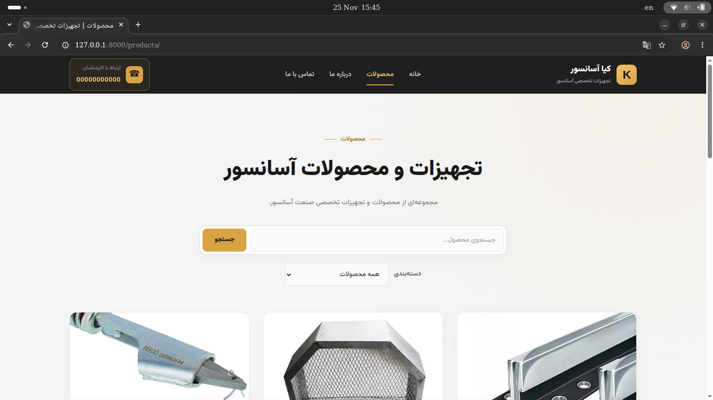
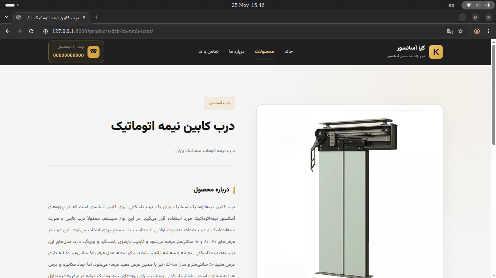
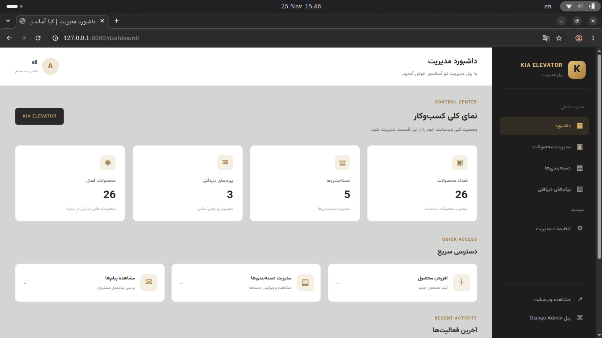
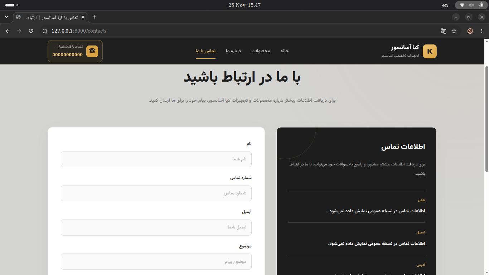

# Kia Elevator

A Django-based product showcase website developed for Kia Elevator, featuring an industrial design, product catalog, and custom management dashboard.

## Overview

Kia Elevator is a responsive web application designed to showcase elevator-related products and provide visitors with an easy way to explore product categories and contact the company.

The project uses Django for backend development and HTML, CSS, and JavaScript for the frontend.

## Features

- Responsive and RTL-compatible interface
- Product catalog and product detail pages
- Product categories
- Product search and pagination
- Contact form with message management
- Custom Django management dashboard
- Product and category management
- Custom error pages
- Sitemap and robots.txt support
- Image validation and optimization

## Technologies

- Python
- Django
- HTML5
- CSS3
- JavaScript
- SQLite
- Pillow

## Project Structure

```text
kia-elevator/
├── config/
├── core/
├── dashboard/
├── static/
├── templates/
├── media/
├── manage.py
├── requirements.txt
└── .gitignore
```

## Installation

### 1. Clone the repository

```bash
git clone https://github.com/mrsh80/kia-elevator.git
cd kia-elevator
```

### 2. Create a virtual environment

```bash
python3 -m venv venv
source venv/bin/activate
```

### 3. Install dependencies

```bash
pip install -r requirements.txt
```

### 4. Configure environment variables

Create a `.env` file in the project root:

```env
SECRET_KEY=your-secret-key
DEBUG=True
ALLOWED_HOSTS=127.0.0.1,localhost
```

Generate a new Django secret key for your local environment. Never publish your actual `.env` file.

### 5. Apply database migrations

```bash
python manage.py migrate
```

### 6. Create an administrator account

```bash
python manage.py createsuperuser
```

### 7. Run the development server

```bash
python manage.py runserver
```

Open the following address in your browser:

```text
http://127.0.0.1:8000/
```

## Environment Variables

| Variable | Description |
|---|---|
| SECRET_KEY | Django secret key |
| DEBUG | Enables or disables debug mode |
| ALLOWED_HOSTS | Allowed hostnames |

## Screenshots

### Homepage


### Products


### Product Details


### Admin Dashboard


### Contact


## License

No open-source license has been specified for this project.
